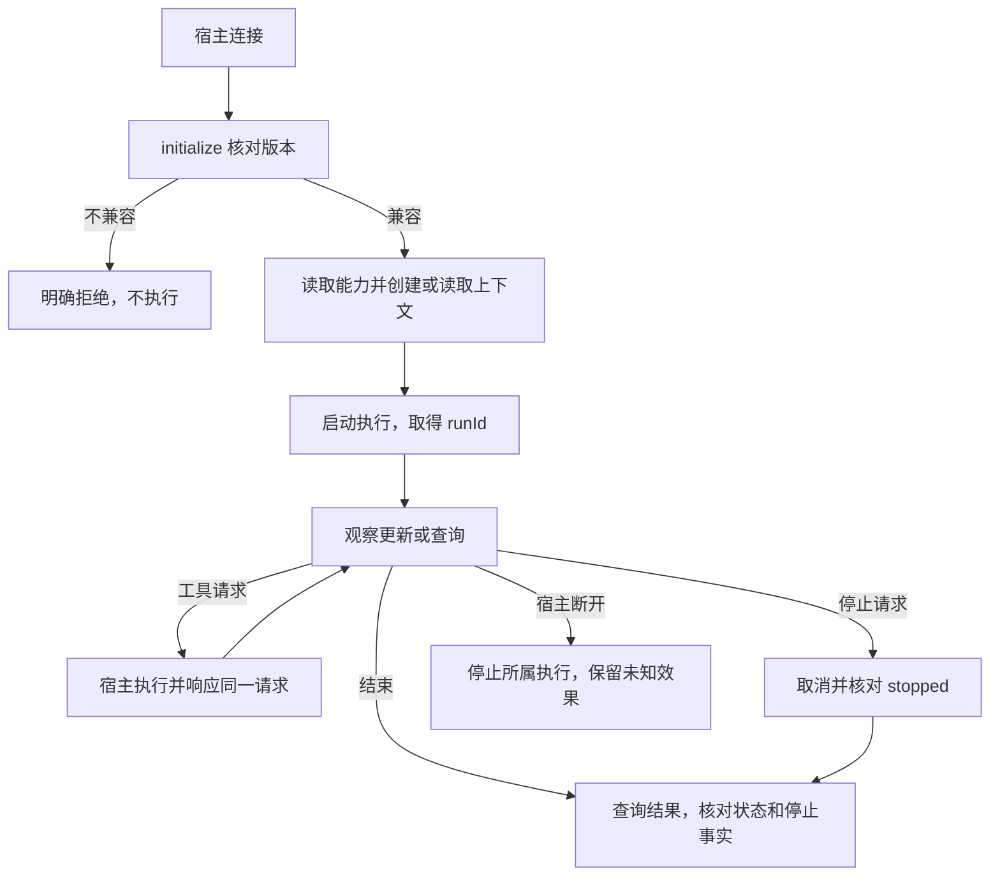

# #277 版本化 Sidecar 执行入口

版本 v0.3；状态：已确认架构范围的技术契约，整票尚未完成设计与验收。
Issue：https://github.com/xforce-io/milkie/issues/277 。

L1: reuse + 整理。确认依据为本次会话中 TaskLoop 通过 Milkie 统一接入不同 Harness、采用本地 Sidecar、宿主保留工具授权与执行职责、异常停止必须可判定的讨论，以及 Epic #5 S1/S2/S5。用户目标为端到端交付 PR，未授权合入/部署。以下协议工作不选择第二真实 Harness、不改变既有执行预算或 TaskLoop 查询入口；这些尚待确认的选择不被本稿默认批准。
L2: write。跨语言进程边界与公共协议需要固定契约。本稿采用用户 AGENTS 的十三节格式；L1 摘要放 Issue comment，细化可判定验收集中在 §11，属于 L1.8 语义映射。

## 1 背景

现有 `ExecutionClient` 统一管理执行上下文、执行记录、取消和宿主工具，Rust 调用方尚无稳定协议；修改前 Codex 未进入受支持列表。现有机制见 `src/execution/ExecutionClient.ts`、`worker.ts`、`types.ts`、`hostTools.ts`。本次先复用这些执行机制提供 stdio 入口，随后补 Codex，最后以两种真实 Harness 验收整票。

## 2 名词解释

沿用 [名词表](../glossary.md)。新增 Sidecar 表示宿主启动并通过本地 stdio 管理的 Milkie 执行协议进程。执行上下文与执行记录不等同于 TaskLoop 业务任务；本协议不推进业务状态。

## 3 目标与非目标

目标：宿主核对版本和支持能力、创建或精确读取上下文、启动/查询/取消执行、响应工具回调和核对未送达结果。所有消息由稳定标识关联。
非目标：网络服务、业务调度、完整 trace 存储治理、凭据复制、隐藏推理采集、自动重试有副作用的调用。本票仍要求 Codex 和第二真实 Harness；仅协议实现不能算整票完成。

## 4 能力

入口 `milkie execution-sidecar --data-dir <absolute-path> --connection-file <absolute-path>`；连接文件由宿主准备，内容为既有 `ConnectionInput`，只读入内存，不回显原始配置或环境。每个 Sidecar 绑定一个连接，能够管理独立执行上下文。启动时不调用模型；配置错误输出安全错误码并退出。

### 4.1 UI/UX

无图形界面。stdout 专供一行一个 JSON-RPC 2.0 消息；stderr 只输出固定错误码，无提示词、凭据、argv 或原生事件。新宿主先 initialize，再创建上下文；没有记录时 query 返回 null，不伪造成功。unsupported 与 availability=unchecked 分开；unchecked 不表示 CLI 已安装或登录有效。进行中通过 execution.updated 获得状态与心跳，最终内容由 execution.query 返回。

S1 覆盖 B→D→E→F→I，S2 覆盖两个独立上下文及 H/J。失败结果需区分执行失败、心跳未知、已停止与未确认停止；未知不当成功，不自动重放。

## 5 思路与折衷

复用 ExecutionClient 和 worker 的权限、上下文锁、专用存储与 ProcessTracker；不在 Sidecar 重写 Harness 协议。放弃 HTTP 服务及常驻连接池，避免新增网络认证与共享执行租约。允许双向请求，避免执行等待工具时阻塞查询/取消。SDK 默认独立生命周期保持兼容；Sidecar 使用宿主生命周期，父进程失联时 worker 自行终止原生进程，不能只靠 Sidecar 的正常清理。单个传输断开不代表工具副作用已撤销。

## 6 架构

分层：Rust 宿主 → Sidecar 协议 → ExecutionClient → worker/原生适配器 → Harness。工具沿反向通道回宿主，授权与结果持久化沿用 SDK。
主路径：initialize→context.create→execution.start→execution.updated/工具回调→execution.query。
失败路径：输入/版本错误在执行前拒绝；进程错误用固定代码；stdin EOF、stdout 故障或终止信号先关闭接入并取消本进程启动的执行；已接受输出最多等待1秒排空，宿主不再读取时不无限等待；Sidecar 被强杀时 worker 从父存活管道/IPC 断开自行发现。记录归 SDK store，不增加第二状态事实源。活动通知不取代持久化查询。

## 7 模块

协议解析、分发与双向工具关联归 execution/sidecar；CLI 仅提供参数和进程入口。ExecutionClient 增加显式宿主生命周期选项，默认独立行为保持不变；worker 统一监督父存活管道。Codex 适配器按固定 CLI 版本协议加入；能力支持不等于已完成真实验收。

## 8 API/CLI

协议版本 `1`，JSON-RPC `2.0`，UTF-8 LF 分帧；输入最大 8 MiB/帧、每连接最多 64 个未完成宿主请求、最多 64 个活动执行和 64 个未响应工具请求，输出缓冲最大 16 MiB。超过边界关闭传输并停止所属执行，不丢消息后继续伪报完整。输入 ID 为 string（最多128字符）或安全整数，不能重复并发使用；工具请求 ID 使用 `tool:<uuid>`，方向独立。拒绝批量消息及有副作用的通知。

- `initialize {protocolVersion:1}` → `{protocolVersion, capabilities}`；不兼容返回 -32001；每连接只允许成功握手一次。
- `capabilities {}` → 既有能力对象；支持不等于就绪。
- `context.create {cwd, storage?}` / `context.get {contextId}` → ExecutionContext。
- `execution.start {contextId, input, constraints?}` → `{runId}`；只有约束 tools 存在时安装工具转发 handler。
- `execution.query {runId}` → ExecutionRecord 或 null。
- `execution.cancel {runId}` → 当前 ExecutionRecord；以 stopped 为停止事实，不能以 RPC 成功当停止确认。
- `tool.get {callId}` / `tool.pending {contextId}` / `tool.reconcile {callId, output}` → 既有工具记录与核对语义。
- Sidecar → 宿主 `tool.call`，params 为 ToolCall。宿主返回既有 ToolResult；error 转为明确 rejected。晚到或未知响应不重放工具、不匹配其它调用。
- Sidecar → 宿主 `execution.updated` 通知：runId、contextId、status、heartbeatAt、stopped、finishedAt?、code?；不携带 output/参数/凭据，不承诺这些通知就是完整 trace。

错误：-32700 JSON 解析，-32600 无效消息，-32601 未知方法，-32602 参数，-32000 执行错误（data.code 为 ExecutionError.code），-32001 版本不兼容，-32002 尚未握手；内部异常 -32603 固定文案，不传播 exception 原文。请求有响应不意味着副作用 exactly-once；连接丢失后只查询/核对，不自动重新 start。

## 9 边界

仅本机受信宿主，stdin 能力即进程操作授权；不对外监听。dataDir/连接文件由宿主显式指定，环境和连接不在消息中回显。每个执行上下文仍受既有连接匹配、锁、专用目录和原生会话校验约束。关闭时只取消本 Sidecar 新启动的执行，不取消读取到的其它宿主执行。跨连接恢复用上下文/执行标识精确查询。宿主生命周期丢失记录 unknown 与实际停止事实，绝不把 lost host 写成 succeeded。

## 10 迁移/兼容/回滚

新增入口和可选生命周期选项，旧 SDK 缺省、API/Pi/Grok 语义不改；既有执行记录不需迁移。协议 v1 不接受不同主版本，后续兼容字段只允许在文档明确的位置扩展。回滚不删除既有上下文、调用和执行记录；未确认停止的执行不能借回滚释放锁。

## 11 测试计划

下列均为必需；S1/S2 主功能文件均为 `.agents/skills/verify-milkie/features/21-execution-sidecar.md`，并链接16–20既有能力。验收编号继承 v0.1；当前契约 v0.3；冻结候选后另填结果，不在此写 pass。

| ID/归属 | 前置与真实入口 | 操作与判定结果/禁止结果 | 证据、执行与层级 |
|---|---|---|---|
| S1.A1 / S1 | 构建产物；stdio CLI；无模型依赖 | 不兼容版本与未握手请求拒绝且无执行；兼容握手返回实际能力 | 原始协议 transcript、dataDir 无执行；agent 可执行；Integration |
| S1.A2 / S1 | 明确版本及宿主准备登录；Codex与第二真实Harness | 经同一入口完成执行、工具请求准确关联、最终结果可读；安装/登录失效不能称就绪 | 两种真实 CLI 版本、请求与持久化结果；需真实服务；E2E |
| S1.A3 / S1 | stdio CLI；确定性子进程 | 非法JSON、帧超限、重复ID、错误工具响应及输出故障可判定；不泄漏配置或错配结果 | transcript、调用计数及退出状态；确定性夹具仅证明协议边界；Integration/Unit |
| S2.A1 / S2 | 两个独立上下文；真实Harness | 并发启动分别查询，取消其一；停止事实可核对，另一个继续且关联无串线 | 两组run/context、停止记录和原生资源退出；需真实服务；E2E |
| S2.A2 / S2 | stdio CLI及确定性子进程 | EOF/强杀宿主时子进程停止，未知效果保留，不重放；不支持约束执行前拒绝 | 进程探针、执行记录和工具计数；Integration |
| S2.A3 / S2 | 既有SDK与原测试入口 | API/Pi/Grok既有专用存储、权限、工具、取消、预算契约仍通过；已有波动单独披露 | test:execution与相关真实回归；Unit/Integration/E2E |

## 12 开放问题

第二真实 Harness 的最终选择与版本矩阵尚未确认；Codex 固定版本已用本机 app-server schema 与官方文档核对，但真实执行环境尚待提供。它们阻止 S1.A2/S2.A1 的整票完成，不阻止与 Harness 无关的协议及父生命周期代码。本稿不设 TaskLoop trace 默认策略和阶段时限。

## 13 关联

- Epic：https://github.com/xforce-io/taskloop/issues/5
- 观测子票：https://github.com/xforce-io/milkie/issues/278
- 下游执行接入：https://github.com/xforce-io/taskloop/issues/6
- 已有心跳波动：https://github.com/xforce-io/milkie/issues/270

### v0.2 增量：Codex 固定版本边界

本增量只补齐既有 S1/S2 的原生适配技术契约，不改变第二 Harness 的待决状态。依据为本机 `codex-cli 0.166.0` 生成的 experimental JSON Schema，以及 [官方 app-server 流程](https://learn.chatgpt.com/docs/app-server)。旧 v0.1 验收编号保持不变，验收不因实现差异减少。

- Codex 使用 app-server stdio，版本必须精确为0.166.0、模型必须显式指定；PATH 由宿主提供，版本不匹配、CLI 缺失、认证失败均明确报错，不调用其它 Harness 或模型。能力报告支持与 readiness=unchecked 分离；原生模型迭代计数无法在该协议可靠强制，因此 modelIterations=false、设置此约束时启动前 unsupported_constraint。
- 初始化禁用 shell、浏览器、图片、技能发现、hooks、远端插件、多 Agent 与 web search，并枚举及再次验证关闭所有继承 MCP。仅提供宿主工具；read-only 为原生进程防御边界，不提供原生读文件能力；standard 在启动前拒绝。未登记原生请求明确拒绝，发现原生效果项视为 policy_mismatch，停止进程。
- CODEX_HOME 指向宿主专用配置目录，sessions 精确绑定专用会话目录，不复制 auth.json。会话必须是持久化、legacy historyMode、非 ephemeral；保存返回的 thread id 和路径，路径 realpath 必须在专用会话目录内，原生 session_meta id/cwd 必须吻合，缺失或错配不能新建替代会话。
- 先 initialize/initialized，再 thread/start 或精确 thread/resume，最后 turn/start。请求和通知只能归属当前 thread/turn。输出取当前回合 agentMessage 的完成文本，不混入历史或 reasoning。实际模型与请求模型不符时拒绝。
- 0.166.0 的 thread/resume 不支持重新传入 dynamicTools。首次工具目录保存在执行上下文；后续只允许同一目录中 schema/description 不变的子集，撤销的名称仍可能出现在原生历史中，但当前授权层必须拒绝；新增或改变工具定义在启动前 unsupported_constraint，不能静默忽略。要更换目录由宿主显式创建新上下文。空工具目录同样记录，不能在第一次无工具后续接时偷偷增加工具。
- 工具请求保留原生 callId，并使用 Milkie 独立 callId。工具输入校验、当前授权、serial/parallel、结果边界及持久化沿用共用分发器；执行结果写回 app-server 管道成功后才能记为送达。宿主已完成但写入失败仍 pending，不能因中间适配器读取到结果就提前记成功。
- 正常回合结束后清理本次 app-server 及子进程，确认停止再公布 succeeded。取消、超时、宿主断开均复用 ProcessTracker；没有确认停止仍 unknown。主动停止不保证远端副作用撤销。任何故障不输出原始 stderr/原生错误对象。
- S1.A2 追加真实 Codex 执行、宿主工具、精确续接；S2.A2 追加模型/版本/跨会话错误及不支持迭代约束、新增工具定义前置拒绝。确定性协议夹具与真实 CLI 验收分开记录。

### v0.3 增量：原生延迟创建会话文件

0.166.0 原生握手探针（无真实凭据、不启动模型回合）证明 thread/start 返回的 path 此时尚不存在。首次执行先通过最深存在祖先的 realpath 与剩余路径定位到专用会话目录内，保存精确 id/path，再发送 turn/start；不把不存在误作原生丢失。完成回合时必须校验已创建 JSONL 的 session_meta id/cwd 才能成功。后续续接仍在启动前强制要求文件存在，绝不把丢失会话当首次执行。确定性夹具同步延迟到 turn/start 创建文件，原 v0.2 的完整套件通过不作为本差异已验证的证据。
