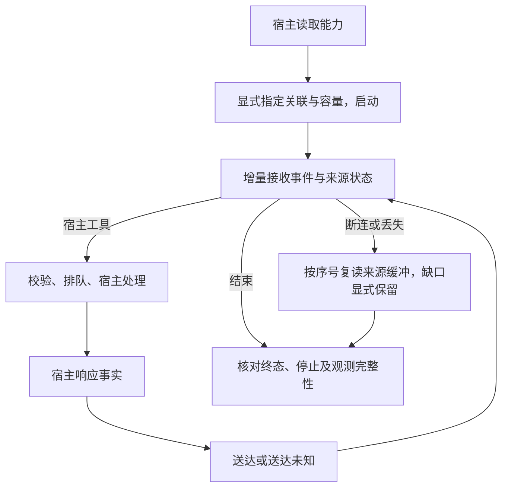

# #278 Harness 观测事件与工具调用关联

版本 v0.1；状态：已确认 Epic 架构范围的设计基线，真实 Harness 验收尚未完成。
Issue：https://github.com/xforce-io/milkie/issues/278 。依赖 #277 的67fd96b；分支以其为堆叠基线，不改写 #277 的未完成验收。
L1: reuse + 整理；来源为会话中「粒度到 Agent 内部工具调用」「Milkie 接入不同 Harness，TaskLoop 集成并统一治理 trace」及本票 S1/S2。仅提供显式启用的 Milkie 数据源，不决定 TaskLoop 默认采集、故障启动策略、查询出口或保留期限；这些原有待决项不视为已批准。
L2: write；跨进程数据、上下文与公共增量查询需要契约。遵循用户 AGENTS 十三节结构；§11 对应 L1.8。

## 1 背景

现有机制核对：`src/trace/types.ts` 是 Milkie 内部 Agent Trace；`execution/worker.ts` 驱动外部 Harness 并写执行终态；`adapters.ts/CliEvents` 只提取原生输出和终态；`codex.ts` 驱动 app-server；`hostTools.ts/createToolDispatcher` 统一校验、排队和回传宿主工具。两者不是同一采集链；目前不存在可供 Rust 宿主统一接收、复读的外部观测事件。

## 2 名词解释

已有术语沿用 [名词表](../glossary.md)。新增执行观测事件描述 Milkie 外部执行边界内已观察到的事实；来源缓冲保存单次执行有界事件，供宿主增量接收和断连后读取。来源缓冲不是 TaskLoop 的跨任务查询或保留策略事实源。

## 3 目标与非目标

目标：同一 SDK/Sidecar 获取生命周期、活动、已报告用量及宿主工具起止/送达事件，保持原生标识与 W3C 关联；明确能力缺口、数据丢失及未知效果。
非目标：模型隐藏推理、推断每个 Harness 都有完整模型请求明细、完整提示词/正文采集、业务状态机、独立监控服务、TaskLoop 默认策略和统一保留。

## 4 能力

SDK 执行时显式提供观测选项和宿主 traceparent，以及有界容量；未提供不启用新来源缓冲，保留已有 SDK 行为。能力声明区分监督层生命周期、原生活动、用量范围和不可观测信息。SDK 按 runId 与来源序号增量读取，Sidecar 同步提供查询及活动通知；宿主不解析原生 CLI 行。

### 4.1 UI/UX

无图形页面。宿主先查询 capabilities 的 observation 字段，按支持范围启动，然后消费 observation.read 或 Sidecar execution.observation 通知。空记录与未启用分别可判定；超限、损坏和未完成均不能显示为完整。原生未提供用量时没有 usage 事件，不能补零。

S1 为 A→B→C→G/H；S2 为 C→D→E→F→C/G。成功意味着可验证的关联事实，不是业务成功；空、错、未知和完整结束各有结构化结果。明确不做 trace 浏览器页面。

## 5 思路与折衷

复用工具分发器与原生解析位置，以类型化安全元数据产生统一事件；不把原生协议当公共必填格式，不复制原始 stderr。先写有界来源缓冲，再由宿主增量接收；放弃仅靠无确认 IPC 推送，避免 worker 退出后无法区分未观察与通知丢失。宿主负责 TaskLoop 的最终治理，来源仅保存显式启用的数据。缓冲异常记录缺口，不改写执行的业务结果；启动前是否要求可用采集由 TaskLoop 后续策略决定。

## 6 架构

分层：原生/API 边界与工具分发器 → 类型化观测器 → 单 writer 来源缓冲 → SDK 增量读取 → Sidecar/Rust 宿主 → TaskLoop。原有执行记录仍是执行状态事实源。
主路径：校验显式选项→创建来源→写开始/能力→写原生与工具事件→写结束→宿主读取同一稳定事件。
失败路径：缓冲达到容量仍保留终止与丢失统计；写入失败、尾帧或损坏均显式不完整；worker 被强杀后不伪造原生结束，宿主由执行状态与来源状态判断缺口。工具送达失败保持 pending，不自动重放。

## 7 模块

`execution/observation` 定义事件、能力、W3C 校验与来源缓冲；worker 产生生命周期/终止；Codex 与 CliEvents 只映射实际暴露的事实；共用工具分发器关联请求、宿主响应与送达。ExecutionClient 与 Sidecar 提供同一分页读取，原有 Agent Trace 独立，后续 TaskLoop 统一接纳。

## 8 API/CLI

- `ExecutionConstraints.observation = {traceparent,maxEvents,maxBytes}` 显式启用；traceparent 使用 W3C 00 格式且 trace/span 非零，maxEvents 必须为2–100000、maxBytes 为4096–67108864的整数；来源预留1条事件及1024字节给终止，普通事件达到任一容量则开始计 dropped；容量必须在此公布边界内，不合法在执行前拒绝。宿主必须指定容量，无隐式无限值。
- `ExecutionClient.observations(runId, afterSequence=0, limit=100)` 与 Sidecar `observation.read {runId,afterSequence?,limit?}` 返回 `{enabled,events,nextSequence,status}`。limit 范围1–1000；不存在执行返回明确错误，不把未启用当空且完整。
- Sidecar 在执行更新周期发送 `execution.observation`，payload 为稳定事件；通知丢失后可按序号复读，重复读取不能重复计算效果。原有协议1新增可选能力与方法，旧调用保持兼容。
- 事件版本1，包含稳定 id、sourceId、单来源递增 sequence、runId/contextId、wall-clock 与单调时钟、kind、traceId/spanId/parentSpanId、可选原生 session/turn/call 标识及类型化 data。Milkie 原生标识不替换成 OTel ID。
- 执行产生 Agent span；工具请求产生子 span，ToolCall 可带其 traceparent，TaskLoop 的实际工具执行 span 以它为父；Milkie 的宿主响应只是观察到结果，不重复计成一次宿主效果。
- 参数与结果仅记录编码字节数及 SHA-256，不复制正文；错误只记录受控 code，不复制异常 message。哈希只作关联校验，不视为对低熵数据的匿名化保证，访问控制仍由宿主实施。
- `ToolResult` 新增 execution_failed 表达宿主执行失败；与权限拒绝、参数失败分别表示。执行被取消时只报告请求中断和未送达，不承诺业务效果回滚。

## 9 边界

每个来源仅属于一个执行。序号是来源顺序，不是跨进程全局时钟；持续时间使用同来源单调时间。只有暴露的 token 字段才记录；累计原生会话计数带 scope，不当成本轮增量；reasoning 是 output 的子集，不能再次相加。Pi 用量字段以本机发行包 pi-ai 的 Usage 与 AssistantMessage 类型核对；有 responseId 时去重，未提供稳定标识时不假设两个相同计数就是同一响应。相同原生通知可去重，有原生调用 id 的重复请求不重复执行；不同 id 仍由宿主业务幂等负责。旧 Grok 不提供原生 callId 时必须明确声明，不伪造一个冒充原生标识。

## 10 迁移/兼容/回滚

增加可选字段、方法和事件类型；没有 observation 的旧执行不产生来源缓冲。工具成功/拒绝/核对语义保留，新增 execution_failed 可供调用方识别；原生扩展继续收到文本错误。回滚保留已写的版本1来源数据；不把它当执行成功依据，不据此重放调用。

## 11 测试计划

下列均为必需；S1/S2 主功能文件均为 `.agents/skills/verify-milkie/features/22-harness-observation.md`。候选结果另行记录，不在设计中预填 pass。

| ID/归属 | 前置、真实入口与路径 | 可判定结果与禁止行为 | 证据/执行/层级 |
|---|---|---|---|
| S1.A1 / S1 | SDK 与 stdio；固定 Codex 和第二真实 Harness | 显式启用→消费事件→核对声明、原生关联及已报告用量；未知不补零、隐藏内容不输出 | 版本、原始路径及事件与能力对照；真实服务；E2E |
| S1.A2 / S1 | 已有执行；SDK/Sidecar 增量查询 | 分页及复读保持相同 id/sequence；未启用、空、超限、损坏、未完成可判定；不把丢失当完整 | 页边界、容量故障、尾帧、相同事件；Integration/Unit |
| S1.A3 / S1 | 不同 traceparent 和两个并发上下文 | 关联不串线；无效关联/容量启动前拒绝；未提供 observation 的原契约不退化 | 双来源记录、拒绝结果及原回归；Integration/Unit |
| S2.A1 / S2 | 两种真实 Harness，宿主处理器 | 成功、执行失败、参数/权限拒绝、取消、送达未知均可关联；宿主响应不当送达；未知不重放 | 原生/宿主调用与事件，停止及 pending 记录；真实服务；E2E |
| S2.A2 / S2 | 共用分发器和真实子进程协议 | 并发不串结果；重复原生通知不重复计效果；参数/结果安全摘要可复算，无正文/凭据/原始异常 | 调用次数、原文缺失、哈希/字节数、traceparent 父子及重复请求；Integration/Unit |

## 12 开放问题

第二真实 Harness、宿主专用目录尚待提供；阻止真实验收，不阻止安全元数据与显式接入代码。TaskLoop 默认采集、前置可用性门及统一保留在相应子票固定，本稿不代替其产品确认。

## 13 关联

- Epic：https://github.com/xforce-io/taskloop/issues/5
- 执行基础：https://github.com/xforce-io/milkie/issues/277
- 下游接入：https://github.com/xforce-io/taskloop/issues/6
- 统一查询/治理：https://github.com/xforce-io/taskloop/issues/7 、https://github.com/xforce-io/taskloop/issues/8
- 标准：[W3C Trace Context](https://www.w3.org/TR/trace-context/)
